<div align="center">



# 🍰 BunCake

**Loja fictícia de bolos de pote, criada para explorar acessibilidade digital e inclusão no comércio eletrônico.**


🔗 **Site publicado:** [`https://<SEU-USUARIO>.github.io/<NOME-DO-REPOSITORIO>/`](https://anaernandes08.github.io/BunCake/) *(substitua após publicar)*

</div>

<!-- BANNER: adicione uma captura de tela do site em Imagens/banner.png e remova este comentário.
<p align="center"></p>
-->

> ⚠️ **Aviso:** a BunCake é um site de teste, feito como projeto acadêmico. Os produtos, preços e pedidos são fictícios e nada é vendido de verdade.

---

## 📑 Índice

1. [Apresentação do projeto](#1-apresentação-do-projeto)
2. [Sobre o projeto](#2-sobre-o-projeto)
3. [Objetivos](#3-objetivos)
4. [Funcionalidades](#4-funcionalidades)
5. [Páginas do site](#5-páginas-do-site)
6. [Recursos de acessibilidade](#6-recursos-de-acessibilidade)
7. [Artigos sobre acessibilidade](#7-artigos-sobre-acessibilidade)
8. [Tecnologias utilizadas](#8-tecnologias-utilizadas)
9. [Estrutura de arquivos](#9-estrutura-de-arquivos)
10. [Como executar o projeto localmente](#10-como-executar-o-projeto-localmente)
11. [Hospedagem](#11-hospedagem)
12. [Testes de acessibilidade](#12-testes-de-acessibilidade)
13. [Referências e materiais complementares](#13-referências-e-materiais-complementares)
14. [Possíveis melhorias futuras](#14-possíveis-melhorias-futuras)

---

## 1. Apresentação do projeto

| Item | Informação |
|---|---|
| **Nome** | BunCake |
| **Tipo** | Site de loja fictícia de bolos de pote |
| **Contexto** | Atividade acadêmica do curso de Engenharia de Software |
| **Foco** | Acessibilidade digital e inclusão |
| **Tecnologias** | HTML, CSS e JavaScript (sem frameworks) |
| **Site publicado** | `https://<SEU-USUARIO>.github.io/<NOME-DO-REPOSITORIO>/` *(preencher)* |

A BunCake apresenta um cardápio de bolos de pote, um carrinho de compras de demonstração e um formulário de contato. Ela também reúne um painel de recursos de acessibilidade que o visitante pode ajustar e uma área de artigos educativos sobre acessibilidade na vida cotidiana.

---

## 2. Sobre o projeto

A BunCake nasceu como atividade do curso de Engenharia de Software. A proposta é mostrar, na prática, como um comércio eletrônico pode ser pensado desde o início para ser usado por pessoas com diferentes necessidades, de modo que elas naveguem com autonomia.

O projeto relaciona três temas:

- **Comércio eletrônico:** a navegação por um cardápio, a escolha de produtos e a gestão de um carrinho são tarefas comuns em lojas virtuais e precisam ser acessíveis a todos.
- **Acessibilidade digital:** pessoas com baixa visão, daltonismo, dislexia, dificuldades motoras ou que usam tecnologias assistivas podem encontrar barreiras em sites mal projetados.
- **Inclusão social:** um site acessível amplia quem pode comprar, ler e participar, e trata a acessibilidade como parte da qualidade do produto.

Além da loja, o site tem um espaço educativo com seis artigos sobre acessibilidade na vida cotidiana (veja a seção [7](#7-artigos-sobre-acessibilidade)).

### Requisitos acadêmicos e situação atual

| Requisito | Situação |
|---|---|
| Utilizar HTML, CSS e JavaScript | ✅ Atendido |
| Possuir ao menos cinco páginas interligadas | ✅ Atendido (10 páginas interligadas) |
| Disponibilizar artigos e textos sobre acessibilidade | ✅ Atendido (6 artigos, veja a seção 7) |
| Estar publicado em um serviço de hospedagem | ⏳ A publicar no GitHub Pages (instruções na seção [11](#11-hospedagem)) |
| Atender às recomendações de acessibilidade web | 🔄 Parcialmente implementado e ainda não auditado (veja as seções [6](#6-recursos-de-acessibilidade) e [12](#12-testes-de-acessibilidade)) |

---

## 3. Objetivos

### Objetivo geral

Desenvolver um site de comércio eletrônico fictício que demonstre boas práticas de acessibilidade digital e promova a inclusão de pessoas com diferentes necessidades.

### Objetivos específicos

- Aplicar HTML semântico, CSS e JavaScript para construir uma loja virtual funcional de demonstração.
- Oferecer ao usuário um painel para personalizar a leitura (fonte, contraste, espaçamento, cores).
- Garantir navegação por teclado e indicação visível de foco.
- Fornecer textos alternativos para as imagens, rótulos para os campos e botões e um link para pular ao conteúdo.
- Tornar o layout adaptável a diferentes tamanhos de tela.
- Disponibilizar conteúdo educativo sobre acessibilidade na vida cotidiana.
- Documentar o processo de verificação de acessibilidade e as melhorias futuras.

> 💡 **Por que interfaces acessíveis importam?** Segundo a Lei Brasileira de Inclusão (Lei nº 13.146/2015), a acessibilidade é um direito. Na prática, ela também melhora a experiência para todos, inclusive para quem usa o celular sob o sol ou está com a mão ocupada.

---

## 4. Funcionalidades

Lista das funcionalidades **efetivamente implementadas** nos arquivos do projeto.

### 🛒 Loja

- **Cardápio** com 6 bolos de pote. Cada item tem foto, nome, descrição dos ingredientes, preço fictício e botão "Adicionar ao carrinho".
- **Carrinho de compras** que lista os itens adicionados, com miniatura, preço unitário, subtotal por item e total geral.
- **Alteração de quantidade** (botões − e +). Quando a quantidade chega a zero, o item é removido.
- **Contador de itens** no cabeçalho, atualizado a cada alteração.
- **Persistência do carrinho** entre páginas. Os dados ficam em `window.name` e no `localStorage`, para funcionar também quando o arquivo é aberto direto do computador.
- **Finalização de compra de demonstração**, que apenas esvazia o carrinho e exibe um aviso. Nenhum pagamento é processado.
- **Formulário de contato** com nome, e-mail e mensagem (campos obrigatórios) e aviso de envio. O envio é só uma simulação: nenhuma mensagem é transmitida.
- **Avisos temporários** (toast) ao adicionar itens, finalizar a compra ou enviar uma mensagem.

### 📚 Conteúdo educativo

- **Página de artigos** com seis artigos sobre acessibilidade (veja a seção [7](#7-artigos-sobre-acessibilidade)).
- Cada artigo tem **sumário com âncoras**, links "Voltar ao sumário" e uma lista de **fontes**.
- O artigo sobre barreiras digitais traz uma **tabela** com legenda e cabeçalhos associados às células.

### ♿ Acessibilidade (painel na página inicial)

- Aumentar e diminuir a fonte (de 80% a 150%), com indicação do valor atual.
- Modo escuro.
- Alto contraste.
- Espaçamento ampliado entre linhas, letras e palavras.
- Fonte de fácil leitura (Verdana/Arial).
- Destaque de links (sublinhado e contorno).
- Escala de cinza.
- Botão "Restaurar padrão".
- As preferências ficam salvas e são aplicadas nas demais páginas, inclusive nos artigos.
- **Link "Pular para o conteúdo"**, visível ao receber o foco do teclado, em todas as páginas.
- Avisos temporários anunciáveis por leitores de tela (`role="status"`).

---

## 5. Páginas do site

| Página | Arquivo | Finalidade | Principais funcionalidades |
|---|---|---|---|
| **Home / Cardápio / Acessibilidade** | `index.html` | Apresentar o projeto, exibir os produtos e permitir a personalização da leitura | Texto de apresentação (site de teste), cardápio com 6 produtos, painel de acessibilidade com 7 recursos e botão de restauração |
| **Carrinho** | `carrinho.html` | Mostrar os itens escolhidos | Lista de itens, ajuste de quantidades, total e finalização de compra de demonstração |
| **Contato** | `contato.html` | Permitir o envio de mensagens | Formulário com validação básica dos campos obrigatórios e aviso de envio (simulado) |
| **Artigos** | `artigos.html` | Reunir o conteúdo educativo | Lista dos seis artigos com tema e resumo, e materiais de referência |
| **Acessibilidade digital** | `acessibilidade-digital.html` | Explicar conceito, números, leis, WCAG e eMAG | Sumário com âncoras, fontes |
| **Acessibilidade na vida cotidiana** | `vida-cotidiana.html` | Mostrar quem se beneficia da acessibilidade no dia a dia | Sumário com âncoras, fontes |
| **Barreiras e tecnologias assistivas** | `barreiras-e-tecnologias-assistivas.html` | Apresentar as barreiras por perfil e os recursos de apoio | Tabela de barreiras, sumário, fontes |
| **Daltonismo e cores** | `daltonismo-e-cores.html` | Explicar o daltonismo e o uso acessível de cor e contraste | Sumário com âncoras, fontes |
| **Libras e inclusão de pessoas surdas** | `libras-e-surdez.html` | Tratar de surdez, Libras, legendas e transcrição | Sumário com âncoras, fontes |
| **Inclusão no comércio eletrônico** | `comercio-eletronico-inclusivo.html` | Relacionar acessibilidade e lojas virtuais | Práticas, ferramentas, estudo de caso, fontes |

A navegação principal usa os links do cabeçalho: **Home**, **Cardápio** e **Acessibilidade** (âncoras da página inicial), **Artigos**, além dos botões **Carrinho** e **Contato**. Os artigos são acessados pela página **Artigos**.
---

## 6. Recursos de acessibilidade

> ℹ️ **Sobre a conformidade:** os recursos abaixo foram relacionados a critérios da [WCAG 2.2](https://www.w3.org/TR/WCAG22/) apenas como **referência de boas práticas**. O site **não possui certificação** e **não teve sua conformidade verificada**. A auditoria ainda precisa ser feita (veja a seção [12](#12-testes-de-acessibilidade)).

### Recursos implementados

| Recurso | Como funciona | Finalidade | Quem pode se beneficiar | Critério WCAG 2.2 relacionado |
|---|---|---|---|---|
| **Ajuste do tamanho da fonte** | Botões A− e A+ alteram o tamanho-base do site de 80% a 150%. Como as medidas usam `rem`, o texto e boa parte do layout acompanham. | Facilitar a leitura | Pessoas com baixa visão, idosos | 1.4.4 Redimensionar texto |
| **Modo escuro** | Troca as variáveis de cor para fundo escuro e texto claro. | Reduzir o brilho e o desconforto visual | Pessoas com fotossensibilidade ou que preferem ambientes escuros | Apoia 1.4.3 Contraste (mínimo) *(contraste ainda não medido)* |
| **Alto contraste** | Aplica fundo preto e texto branco. | Maximizar a distinção entre texto e fundo | Pessoas com baixa visão | 1.4.3 / 1.4.6 Contraste |
| **Espaçamento do texto** | Aumenta o espaçamento de linhas, letras e palavras. | Melhorar a legibilidade | Pessoas com dislexia ou baixa visão | 1.4.12 Espaçamento de texto |
| **Fonte de fácil leitura** | Troca a fonte por Verdana/Arial. | Facilitar a leitura de textos | Pessoas com dislexia ou baixa visão | Boa prática (apoia 1.4.8) |
| **Destaque de links** | Sublinha os links e adiciona um contorno. | Tornar os links fáceis de identificar | Pessoas com baixa visão ou daltonismo | 1.4.1 Uso de cor |
| **Escala de cinza** | Aplica um filtro em tons de cinza ao site inteiro. | Simular ou reduzir a dependência de cores | Pessoas sensíveis a cores vibrantes | Boa prática (não substitui a adaptação para daltonismo) |
| **Preferências persistentes** | As escolhas ficam salvas e valem em todas as páginas. | Evitar que o usuário reconfigure tudo a cada página | Todos os usuários do painel | 3.2.3 Navegação consistente (apoio) |
| **Indicador visual de foco** | Links, botões e campos recebem um contorno dourado de 3 px ao ganhar foco (`:focus-visible`). | Mostrar onde está o foco do teclado | Pessoas que navegam por teclado | 2.4.7 Foco visível |
| **Navegação por teclado** | Os controles são elementos nativos (`<a>`, `<button>`, `<input>`, `<textarea>`), focáveis e acionáveis pelo teclado. | Permitir o uso sem mouse | Pessoas com deficiência motora ou que usam leitor de tela | 2.1.1 Teclado |
| **Textos alternativos** | As fotos dos bolos têm `alt` descritivo ("Bolo de pote …") e o logo tem `alt="Logo BunCake"`. As miniaturas do carrinho têm `alt` vazio por serem decorativas, já que o nome do item está ao lado. | Descrever o conteúdo visual | Pessoas cegas ou com baixa visão | 1.1.1 Conteúdo não textual |
| **HTML semântico** | Uso de `header`, `nav`, `main`, `section`, `article`, `footer`, `lang="pt-br"` e um único `h1` por página, com títulos em hierarquia (`h1`–`h3`). | Dar estrutura e permitir a navegação por regiões e títulos | Usuários de leitor de tela | 1.3.1 Informações e relações; 3.1.1 Idioma da página |
| **Rótulos acessíveis (ARIA)** | Os botões de ícone/símbolo (A−, A+, −, +) e os campos do formulário têm `aria-label`. | Informar o propósito dos controles ao leitor de tela | Usuários de leitor de tela | 4.1.2 Nome, função, valor; 3.3.2 Rótulos ou instruções |
| **Link para pular ao conteúdo** | Um link no início da página leva direto ao `main`, ficando visível quando recebe o foco. | Evitar repetir o menu a cada página visitada com o teclado | Pessoas que navegam por teclado ou leitor de tela | 2.4.1 Ignorar blocos |
| **Avisos para leitores de tela** | O aviso temporário usa `role="status"`. | Anunciar confirmações (como "item adicionado") sem mover o foco | Usuários de leitor de tela | 4.1.3 Mensagens de status |
| **Navegação nos artigos** | Sumário com âncoras e links "Voltar ao sumário" nos textos longos; tabela com `caption` e `scope`; links externos com texto descritivo. | Facilitar a leitura de conteúdos extensos | Pessoas que navegam por teclado ou leitor de tela | 2.4.4 Finalidade do link; 1.3.1 Informações e relações |
| **Layout adaptável** | A página usa Flexbox (com quebra de linha), uma grade com `repeat(auto-fill, minmax())` e a meta tag `viewport`. | Permitir o uso em celulares e telas variadas | Usuários de dispositivos móveis | 1.4.10 Reflow *(a verificar)* |

### Recursos ainda não implementados

| Recurso | Situação |
|---|---|
| **Libras (ex.: VLibras)** | ❌ O site não possui tradução para Libras. O tema é tratado em um artigo, e a integração é uma melhoria futura. |
| **Adaptação específica para daltonismo** | ❌ Não há filtros ou paletas específicas por tipo de daltonismo. A escala de cinza e o destaque de links ajudam, mas não substituem essa adaptação. |
| **Media queries específicas** | ❌ O layout é fluido, mas não há regras `@media` dedicadas. |
| **Verificação de contraste** | ⏳ As cores da paleta ainda não tiveram a razão de contraste medida. |

---

## 7. Artigos sobre acessibilidade

O site tem uma área educativa (`artigos.html`) com seis artigos, escritos com redação própria a partir dos materiais listados na seção [13](#13-referências-e-materiais-complementares). Todos têm sumário com âncoras, fontes ao final e um único `h1`.

| Artigo | Tema | Objetivo | Importância para a sociedade |
|---|---|---|---|
| [Acessibilidade digital: o que é e por que importa](acessibilidade-digital.html) | Acessibilidade digital | Apresentar o conceito, os números, as leis, as WCAG e o eMAG | Mostra que a internet precisa ser utilizável por todas as pessoas e que isso é um direito |
| [Acessibilidade na vida cotidiana](vida-cotidiana.html) | Vida cotidiana | Relacionar a acessibilidade a situações do dia a dia e a quem se beneficia | Evidencia que ela ajuda toda a população, e não só pessoas com deficiência permanente |
| [Barreiras digitais e tecnologias assistivas](barreiras-e-tecnologias-assistivas.html) | Barreiras e tecnologias assistivas | Mostrar barreiras por perfil e recursos como leitores de tela e linha braille | Gera empatia e orienta a remoção das barreiras |
| [Daltonismo e percepção das cores](daltonismo-e-cores.html) | Daltonismo | Explicar o daltonismo e o uso acessível de cor e contraste | Evita que a cor seja a única forma de transmitir informação |
| [Libras e inclusão de pessoas surdas](libras-e-surdez.html) | Libras e surdez | Tratar de perfis de pessoas surdas, legendas, transcrição e Libras | Reconhece a diversidade de comunicação das pessoas surdas |
| [Inclusão no comércio eletrônico](comercio-eletronico-inclusivo.html) | Comércio eletrônico | Reunir práticas, ferramentas e um estudo de caso de acessibilidade | Amplia o acesso ao consumo e o público atendido pelas lojas |
---

## 8. Tecnologias utilizadas

| Tecnologia | Função no projeto |
|---|---|
| **HTML5** | Estrutura e semântica das páginas |
| **CSS3** | Estilo visual, variáveis de cor (`:root`), Flexbox, CSS Grid e temas de acessibilidade |
| **JavaScript (ES6+)** | Renderização do cardápio e do carrinho, preferências de acessibilidade, avisos e formulário |
| **Google Fonts (Poppins)** | Tipografia padrão do site |
| **Web Storage (`localStorage`) e `window.name`** | Armazenamento do carrinho e das preferências no navegador |
| **Git e GitHub** | Controle de versão e hospedagem do código |
| **GitHub Pages** | Publicação gratuita do site |
| **Visual Studio Code + Live Server** | Ambiente de desenvolvimento e servidor local |

> O projeto **não utiliza** frameworks, bibliotecas JavaScript ou back-end.

---

## 9. Estrutura de arquivos

```text
BunCake/
├── index.html                              # Home, cardápio e painel de acessibilidade
├── carrinho.html                           # Carrinho de compras
├── contato.html                            # Formulário de contato
├── artigos.html                            # Lista dos artigos
├── acessibilidade-digital.html             # Artigo
├── vida-cotidiana.html                     # Artigo
├── barreiras-e-tecnologias-assistivas.html # Artigo
├── daltonismo-e-cores.html                 # Artigo
├── libras-e-surdez.html                    # Artigo
├── comercio-eletronico-inclusivo.html      # Artigo
├── style.css                               # Estilos, variáveis de cor e temas de acessibilidade
├── script.js                               # Produtos, carrinho, preferências e formulário
├── README.md                               # Documentação do projeto
└── Imagens/
    ├── LogoBunCake.png                     # Logo da loja
    ├── bolo-ninho-coco.jpg
    ├── bolo-chocolate.jpg
    ├── bolo-maracuja.jpg
    ├── bolo-doce-de-leite.jpg
    ├── bolo-acai.jpg
    └── bolo-morango.jpg
```

| Item | Finalidade |
|---|---|
| Arquivos `.html` | Páginas da loja (`index`, `carrinho`, `contato`) e do conteúdo educativo (`artigos` e os seis artigos) |
| `Imagens/` | Guarda o logo e as fotos dos produtos |
| `style.css` | Reúne a identidade visual (paleta marrom, dourado e rosa), os estilos dos artigos e as classes dos recursos de acessibilidade |
| `script.js` | A constante `PRODUTOS` define o cardápio. Para alterar nomes, preços ou descrições, basta editá-la |
---

## 10. Como executar o projeto localmente

### Pré-requisitos

- Um navegador atualizado (Chrome, Edge, Firefox ou Safari).
- [Git](https://git-scm.com/downloads) instalado.
- [Visual Studio Code](https://code.visualstudio.com/) instalado.

Para conferir se o Git está instalado, abra o terminal e digite:

```bash
git --version
```

### Passo a passo

**1. Clone o repositório**

```bash
git clone https://github.com/<SEU-USUARIO>/<NOME-DO-REPOSITORIO>.git
```

**2. Acesse a pasta do projeto**

```bash
cd <NOME-DO-REPOSITORIO>
```

**3. Abra o projeto no VS Code**

```bash
code .
```

Se o comando `code` não funcionar, abra o VS Code e escolha **Arquivo → Abrir Pasta…** e selecione a pasta do projeto.

**4. Instale a extensão Live Server**

1. No VS Code, abra a aba **Extensões** (`Ctrl + Shift + X`).
2. Pesquise por **Live Server** (autor: Ritwick Dey).
3. Clique em **Instalar**.

**5. Execute o site**

1. Abra o arquivo `index.html`.
2. Clique com o botão direito no editor e escolha **Open with Live Server**. Outra opção é clicar em **Go Live**, no canto inferior direito.
3. O navegador abrirá em um endereço como `http://127.0.0.1:5500/index.html`.

**6. Teste as funcionalidades**

- Role até o **Cardápio** e clique em **Adicionar ao carrinho** em alguns bolos.
- Abra o **Carrinho**, altere as quantidades e finalize a compra de teste.
- No painel de **Acessibilidade**, teste o tamanho da fonte, o modo escuro, o alto contraste e as demais opções.
- Na página de **Contato**, preencha e envie o formulário de demonstração.
- Tente navegar apenas com o teclado (`Tab`, `Shift + Tab`, `Enter`).

> 💡 Também é possível abrir o `index.html` com um duplo clique. Para o carrinho funcionar corretamente, é recomendável usar o Live Server ou o site publicado.

---

## 11. Hospedagem

O site é estático, então pode ser publicado gratuitamente no **GitHub Pages**.

1. **Crie uma conta** em [github.com](https://github.com), caso ainda não tenha.
2. **Crie um repositório** público (por exemplo, `buncake`).
3. **Envie os arquivos** do projeto. O `index.html` precisa estar na raiz do repositório:

   ```bash
   git init
   git add .
   git commit -m "Primeira versão do site BunCake"
   git branch -M main
   git remote add origin https://github.com/<SEU-USUARIO>/<NOME-DO-REPOSITORIO>.git
   git push -u origin main
   ```

4. No repositório, abra **Settings** (Configurações) → **Pages**.
5. Em **Build and deployment → Source**, escolha **Deploy from a branch**.
6. Em **Branch**, selecione `main` e a pasta `/ (root)` e clique em **Save**.
7. Aguarde alguns minutos. O endereço publicado aparecerá no topo da página de **Pages**:

   ```text
   https://<SEU-USUARIO>.github.io/<NOME-DO-REPOSITORIO>/
   ```

8. Copie o endereço e atualize o link no início deste README.

> A documentação oficial está em [docs.github.com/pt/pages](https://docs.github.com/pt/pages).

---

## 12. Testes de acessibilidade

> ⚠️ **Situação atual:** **nenhum dos testes abaixo foi registrado como realizado até o momento.** A tabela serve de roteiro e deve ser atualizada com as datas e os resultados reais.

| Método / ferramenta | Como utilizar | Situação | Resultado |
|---|---|---|---|
| **Google Lighthouse** | No Chrome, abra as Ferramentas do Desenvolvedor (`F12`) → aba **Lighthouse** → marque **Accessibility** → **Analyze page load**. | ⏳ Recomendado | *a preencher* |
| **WAVE** | Use a extensão ou o site [wave.webaim.org](https://wave.webaim.org/) e informe a URL publicada. | ⏳ Recomendado | *a preencher* |
| **axe DevTools** | Instale a [extensão axe DevTools](https://www.deque.com/axe/devtools/) e execute **Scan all of my page**. | ⏳ Recomendado | *a preencher* |
| **Navegação somente por teclado** | Use `Tab`, `Shift + Tab`, `Enter` e `Espaço`, sem o mouse. Verifique se tudo é alcançável e se o foco aparece. | ⏳ Recomendado | *a preencher* |
| **Leitor de tela** | Teste com [NVDA](https://www.nvaccess.org/) (Windows), VoiceOver (macOS/iOS) ou TalkBack (Android). | ⏳ Recomendado | *a preencher* |
| **Verificação de contraste** | Meça as combinações de cor no [WebAIM Contrast Checker](https://webaim.org/resources/contrastchecker/). A WCAG pede razão mínima de 4,5:1 para texto normal. | ⏳ Recomendado | *a preencher* |
| **Simulação de daltonismo** | Nas Ferramentas do Desenvolvedor do Chrome: **Rendering** → **Emulate vision deficiencies**. | ⏳ Recomendado | *a preencher* |
| **Zoom e reflow** | Amplie a página até 200% e use uma janela estreita para verificar se o conteúdo continua legível. | ⏳ Recomendado | *a preencher* |

---

## 13. Referências e materiais complementares

| Referência | Descrição |
|---|---|
| [W3C Web Accessibility Initiative (WAI)](https://www.w3.org/WAI/) | Iniciativa do W3C com guias, tutoriais e padrões de acessibilidade web. |
| [WCAG 2.2](https://www.w3.org/TR/WCAG22/) | Diretrizes de Acessibilidade para Conteúdo Web, a principal referência técnica internacional. |
| [eMAG – Modelo de Acessibilidade em Governo Eletrônico](https://www.gov.br/governodigital/pt-br/acessibilidade-e-usuario/acessibilidade-digital) | Modelo brasileiro de acessibilidade para sites e serviços do governo. |
| [Movimento Web para Todos](https://mwpt.com.br/) | Iniciativa brasileira de conscientização sobre a acessibilidade na web. |
| [VLibras](https://www.gov.br/governodigital/pt-br/vlibras) | Ferramenta gratuita do governo federal que traduz conteúdos digitais para a Língua Brasileira de Sinais. |
| [MDN Web Docs – Acessibilidade](https://developer.mozilla.org/pt-BR/docs/Web/Accessibility) | Documentação técnica em português sobre práticas de acessibilidade em HTML, CSS, JavaScript e ARIA. |
| [Lei Brasileira de Inclusão (Lei nº 13.146/2015)](https://www.planalto.gov.br/ccivil_03/_ato2015-2018/2015/lei/l13146.htm) | Estatuto da Pessoa com Deficiência, que trata do direito à acessibilidade, inclusive digital. |
| [WebAIM](https://webaim.org/) | Recursos e ferramentas práticas, como o verificador de contraste. |
| [Governo Digital – Acessibilidade Digital](https://www.gov.br/governodigital/pt-br/acessibilidade-e-usuario/acessibilidade-digital) | Página do governo federal sobre o conceito, os objetivos e os benefícios da acessibilidade digital. |
| [Alura – Acessibilidade digital: 7 dicas para conteúdos acessíveis](https://www.alura.com.br/artigos/acessibilidade-digital-criar-conteudos-acessiveis-aprenda-7-dicas) | Artigo com conceitos, legislação e dicas práticas, como descrição de imagens e legendas. |
| [Perto Digital – As 5 principais ferramentas de acessibilidade para websites](https://www.pertodigital.com.br/blog/as-5-principais-ferramentas-de-acessibilidade-para-websites) | Artigo de blog de uma empresa do setor sobre tipos de deficiência e ferramentas para sites. |
| Enap. *eMAG Conteudista – Módulo 1: Introdução* e *Módulo 2: Web Acessível* (2016) | Material de curso sobre barreiras, tecnologias assistivas e práticas de web acessível. |
| LEUCK, Ágata. *Acessibilidade em Sites e Aplicações Web: Estudo de Caso do Portal da UFRGS* (UFRGS, 2025) | Monografia que avalia o portal da UFRGS com a metodologia WCAG-EM. |

> 🔎 Os links podem mudar com o tempo. Confira se continuam ativos antes de entregar o trabalho.

---

## 14. Possíveis melhorias futuras

**Requisitos acadêmicos pendentes**

- [ ] Publicar o site no GitHub Pages e atualizar o link neste README.
- [ ] Realizar e documentar os testes de acessibilidade (seção 12).

**Acessibilidade**

- [ ] Integrar o **VLibras** para tradução em Libras.
- [ ] Medir e ajustar o contraste da paleta de cores.
- [ ] Oferecer paletas específicas para os tipos de daltonismo.
- [ ] Adicionar `@media` queries e um menu adaptado para telas pequenas.
- [ ] Respeitar as preferências do sistema (`prefers-color-scheme`, `prefers-reduced-motion`).
- [ ] Adicionar um recurso de leitura em voz alta.
- [ ] Incluir transcrições, legendas e audiodescrição caso o site passe a ter vídeos ou áudios.

**Loja**

- [ ] Adicionar filtros e busca no cardápio.
- [ ] Incluir informações de alergênicos e restrições alimentares.
- [ ] Criar uma página de produto com mais detalhes.
- [ ] Integrar o formulário de contato a um serviço de envio de e-mails.
- [ ] Simular etapas de checkout (endereço e pagamento fictícios).
---

<div align="center">

Feito com 🧁 e atenção à acessibilidade.
*BunCake – site de teste, sem fins comerciais.*

</div>
